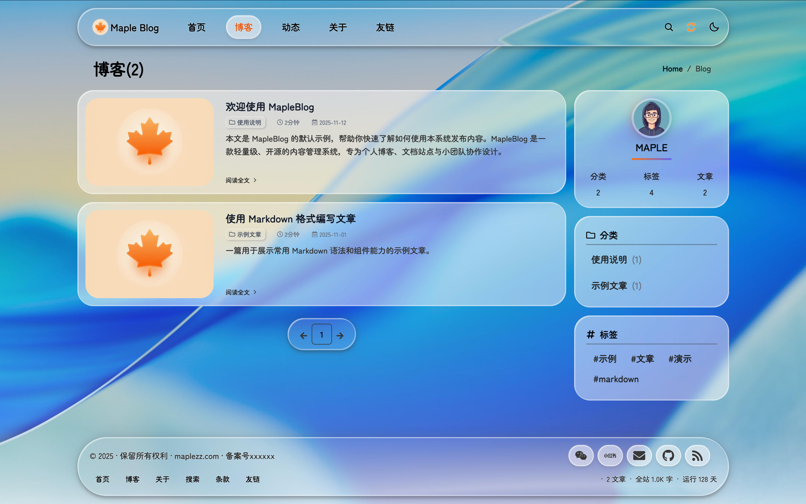
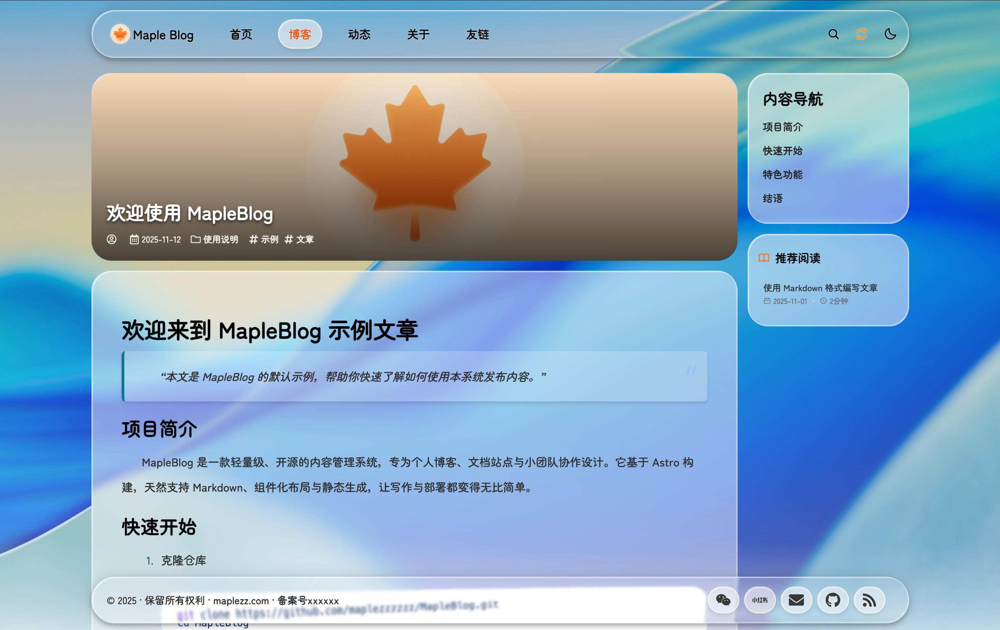

# MapleBlog

[](https://github.com/maplezzzzzz/MapleBlog/blob/main/package.json)
[](https://github.com/maplezzzzzz/MapleBlog/commits/main)
[](https://nodejs.org/en)


一个基于 Astro 的现代化内容站点，支持博客、笔记、友链、评论与本地搜索。

## 🌟 核心特性

### 功能特性
- 📝 内容管理：博客、笔记、页面、友链、首页卡片
- 💬 评论系统：集成 Twikoo，支持多平台评论管理
- 👥 友链系统：支持本地 JSON 配置（`public/data/friends.json`）
- 🔍 全文搜索：基于 Astro 内容构建的本地搜索
- 🌓 深色/浅色模式：可切换深色或浅色模式
- 📱 响应式设计：适配桌面、平板、手机多端
- ⚡ 高性能：静态生成 + 边缘缓存，首屏极速加载

### 网站截图
首页截图

列表页截图

内容页截图

友情链接


### 技术栈
- 前端框架：Astro 5.x + React 18 + TypeScript 5
- 样式方案：Tailwind CSS 3 + PostCSS + SCSS
- 内容管理：文件内容集合（Astro Content Collections）
- 部署平台：Netlify / Vercel / 自建服务器


## 🚀 快速开始

### 环境要求
- `Node.js >= 18`（推荐 20/22）
- `npm >= 9` 或 `pnpm >= 8`

### 安装与运行
- 安装依赖：`npm install`
- 本地开发：`npm run dev`，默认在 `http://localhost:4321/`
- 生产构建：`npm run build:prod`（推荐）或 `npm run build`
- 预览构建产物：`npm run preview`

> **注意**：生产构建前请确保 `.env` 中 `PUBLIC_ENV=production`，否则 `og:url`、`sitemap`、`rss` 等会使用本地地址。

### 环境变量（.env）
在项目根目录创建 `.env`，常用变量如下：

```
# 站点信息
PUBLIC_SITE_URL=https://your-domain.com
PUBLIC_ENV=development   # development | production | test
PUBLIC_DEBUG=false       # 是否输出 debug 日志
PUBLIC_LOG_LEVEL=info    # debug | info | warn | error

# Twikoo 评论
PUBLIC_TWIKOO_ENV_ID=https://your-twikoo-service-url.example.com/.netlify/functions/twikoo
```


生产构建前，请将 `PUBLIC_SITE_URL` 设置为站点实际使用的公开 HTTPS 地址；RSS、站点地图和 robots.txt 会使用这个地址。

### 内容创作
- 在 `src/content/blog/`、`src/content/notes/` 等目录新增 Markdown 文件
- 基础 Frontmatter 示例：

```
---
title: "文章标题"
description: "文章摘要"
pubDate: "2025-11-11"
tags: ["随笔", "技术"]
cover: "/assets/uploads/cover.jpg"
---

正文内容，Markdown格式……
```

## 📦 部署指南

### Netlify
- 构建命令：`npm run build`
- 发布目录：`dist`
- 在 Site Settings 配置环境变量

### 自建静态托管
- 执行 `npm run build`
- 将 `dist/` 上传到你的静态服务器（Nginx、Apache、OSS 等）

## ⚙️ 功能配置

### 友链系统
友链数据使用 `public/data/friends.json` 管理，支持分类与排序。

1. 在 `public/data/friends.json` 增加分类与友链
2. 页面组件 `src/components/common/FriendLinks.astro` 会在客户端读取 JSON 并动态渲染

### 评论系统（Twikoo）
支持 Vercel、Netlify、腾讯云 等多种部署方式。

1. 部署 Twikoo（例如Netlify部署）
2. 获取云函数地址，填入 `.env` 的 `PUBLIC_TWIKOO_ENV_ID`

注：PUBLIC_TWIKOO_ENV_ID 是 Twikoo 的环境 ID，在这里是一个云函数地址，具体部署方法可以参考官方文档：[Netlify部署](https://twikoo.js.org/backend.html#netlify-部署)

## 📁 项目结构

```
MapleBlog/
├── public/                 # 静态资源（图片、favicon）
│   └── data/              # 本地数据（friends.json）
├── src/
│   ├── components/        # Astro + React 组件
│   │   ├── base/        # 布局组件（Header、Footer、BaseLayout）
│   │   ├── blog/        # 博客相关（文章列表、标签、搜索）
│   │   ├── common/      # 通用组件（友链、评论）
│   │   └── ui/          # 基础 UI（按钮、卡片、图标）
│   ├── content/         # 内容源（Markdown / YAML）
│   │   ├── blog/        # 博客文章（博客文章放在这里，md格式）
│   │   ├── notes/       # 动态内容（动态内容放在这里，md格式）
│   │   ├── pages/       # 静态页面（静态页面放在这里，md格式）
│   ├── lib/             # 工具函数与配置
│   │   ├── config.ts    # 站点配置（SEO、分页）
│   │   └── utils/       # 通用工具（日期、字符串、URL）
│   ├── pages/           # 路由页面（在这里调整页面逻辑）
│   └── styles/          # 全局样式（Tailwind + SCSS）
├── .env.example         # 环境变量示例
├── astro.config.mjs     # Astro 配置
├── tailwind.config.js   # Tailwind 配置
└── tsconfig.json        # TypeScript 配置
```

## 🛠 开发与定制

- 修改 `src/lib/config.ts` 调整站点信息与分页等
- 在 `src/content` 目录新增 Markdown 内容（博客、页面、笔记）
- 本地模式下，友链通过 `public/data/friends.json` 管理

## 📚 扩展文档

- [LiquidGlass 组件使用说明](docs/LiquidGlass组件.md)
- [Twikoo 自定义样式解决方案](docs/Twikoo自定义样式.md)
- [友情链接配置指南](docs/友情链接配置.md)
- [生成网站地图](docs/生成网站地图.md)
- [网站流量统计设置指南](docs/网站流量统计.md)
- [组件标签目录说明](docs/组件标签目录说明.md)

## 🤝 贡献指南

欢迎通过 PR、Issue、Discussions 参与改进。

## 📄 许可证

本项目使用 MIT 许可证，详见 LICENSE。

## 🙏 致谢

- [Astro](https://astro.build/)
- [Astrogon](https://github.com/astrogon/astrogon)
- [Tailwind CSS](https://tailwindcss.com/)
- [liquid-glass-effect-macos](https://github.com/lucasromerodb/liquid-glass-effect-macos)

